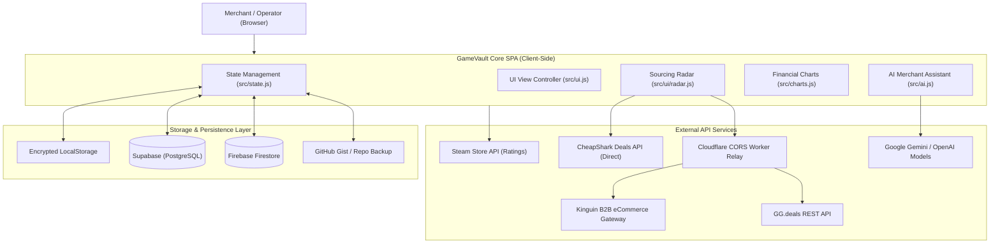
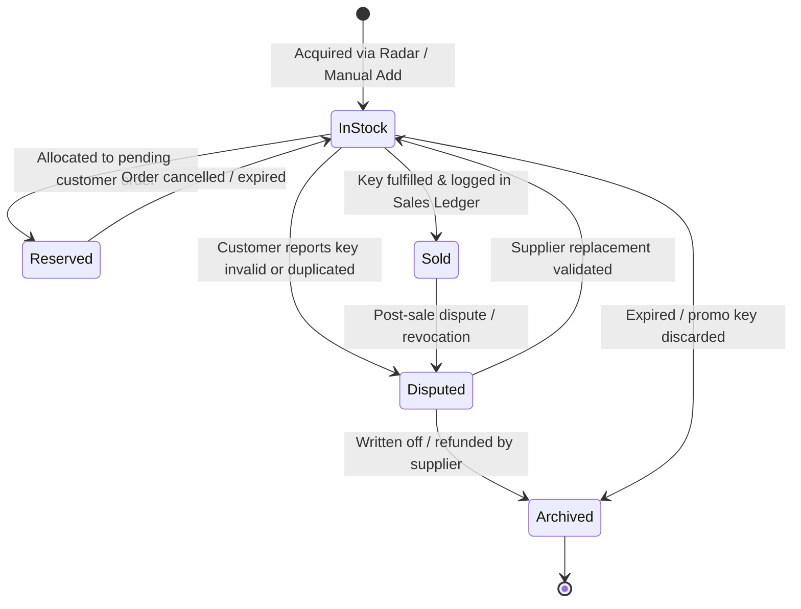
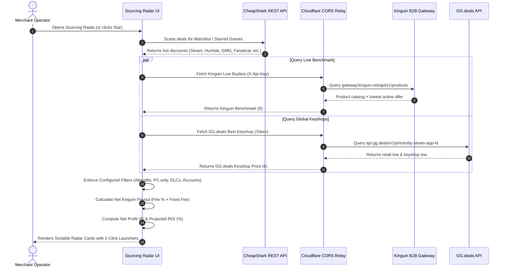
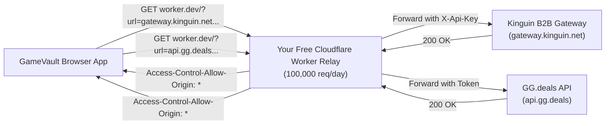

# GameVault (Key Merchant Pro) — Complete Operational & Technical Manual

> **Version**: 3.4.7  
> **Target Audience**: Digital Game Key Merchants, Resellers, Arbitrage Traders, Store Administrators, and Developers.  
> **Platform**: Client-Side Single Page Application (Zero-Build Modular Architecture)

---

## Table of Contents
1. [Introduction & System Architecture](#1-introduction--system-architecture)
2. [Quickstart & Initial Setup](#2-quickstart--initial-setup)
3. [Dashboard & Financial Analytics](#3-dashboard--financial-analytics)
4. [Inventory Pipeline & Key Management](#4-inventory-pipeline--key-management)
5. [Sales Ledger & Net Margin Auditing](#5-sales-ledger--net-margin-auditing)
6. [Sourcing Radar & Kinguin Arbitrage Engine](#6-sourcing-radar--kinguin-arbitrage-engine)
7. [Marketplace & Keyshop Filtering Intelligence](#7-marketplace--keyshop-filtering-intelligence)
8. [Supplier Management & Radar Synchronization](#8-supplier-management--radar-synchronization)
9. [Dispute Resolution & Ledger Protection](#9-dispute-resolution--ledger-protection)
10. [Steam Ratings Enricher](#10-steam-ratings-enricher)
11. [AI Merchant Assistant](#11-ai-merchant-assistant)
12. [Cloud Synchronization & Backup Systems](#12-cloud-synchronization--backup-systems)
13. [Security, Profiles & Access Control](#13-security-profiles--access-control)
14. [External APIs & Cloudflare CORS Relay Guide](#14-external-apis--cloudflare-cors-relay-guide)
15. [Troubleshooting & FAQ](#15-troubleshooting--faq)

---

## 1. Introduction & System Architecture

### 1.1 Purpose & Mission
**GameVault (Key Merchant Pro)** is a digital game license inventory pipeline, sales ledger, and real-time financial arbitrage intelligence suite. It is tailored for independent digital key merchants, marketplace power sellers (especially on **Kinguin**, **G2A**, and **Eneba**), and digital game distributors.

GameVault streamlines the entire lifecycle of digital activation keys:
- **Acquisition**: Sourcing discount deals across 13+ authorized digital stores via CheapShark.
- **Evaluation**: Comparing wholesale buy prices against live competitor prices on Kinguin and global keyshops on GG.deals.
- **Inventory Tracking**: Safeguarding key codes, platform designations, cost basis, and stock states.
- **Ledger Auditing**: Calculating exact net margins after marketplace commission percentages and fixed fees.
- **Intelligence**: Enhancing catalog insight with automated Steam review statistics and AI co-pilot insights.

### 1.2 Zero-Build Client-Side Architecture
GameVault is intentionally engineered without heavy node build tools, Webpack, Vite, or framework bundles. It executes directly in any modern web browser as pure HTML5, vanilla JavaScript (ES2022+), and CSS3.

### 1.3 Key Technical Advantages
- **Instant Deployment**: Hostable on GitHub Pages, Cloudflare Pages, Netlify, or any static HTTP web server.
- **Zero Lock-In**: Complete database export/import via standardized JSON, CSV, and SQL schemas.
- **High Resiliency (Stale-While-Revalidate)**: Operates 100% offline using `LocalStorage`; automatically syncs with Supabase or Firebase when network connectivity is present.
- **Zero API Credential Exposure**: API keys (Kinguin, GG.deals, Supabase, Gemini) remain exclusively inside the merchant's local browser memory or private relay proxy.

---

## 2. Quickstart & Initial Setup

### 2.1 First-Time Launch
1. Open `index.html` in your web browser (or navigate to your hosted GitHub Pages URL).
2. Set up your master merchant profile or initial credentials when prompted.
3. Access the primary navigation bar on the left sidebar:
   - **Dashboard**: Financial analytics, charts, and key performance indicators.
   - **Inventory**: Digital activation key database.
   - **Sales Ledger**: Recorded sales, revenue, customer orders, and net profit.
   - **Suppliers**: Directory of vendors and retailer deals scanning toggles.
   - **Disputes**: Resolution tracker for revoked, regional-locked, or invalid keys.
   - **Sourcing Radar**: Real-time cross-store arbitrage deal finder.
   - **Settings**: API connections, Cloud sync, appearance, and security.

### 2.2 Default Configuration Files
- [config.js](file:///C:/Users/Liza/.gemini/antigravity/scratch/game-sales-tracker/config.js): Contains global defaults for deployment version (`APP_VERSION`), default Supabase credentials, and Firebase configurations.
- [styles.css](file:///C:/Users/Liza/.gemini/antigravity/scratch/game-sales-tracker/styles.css): High-contrast dark theme variables, responsive grid breakpoints, and typography.

> [!TIP]
> Use the keyboard shortcut **`Ctrl + /`** (or click the help icon in the top header) at any time to open the built-in Help & Keyboard Shortcuts guide.

---

## 3. Dashboard & Financial Analytics

The **Dashboard** (`#dashboard-view`) serves as the command center for your business, summarizing financial health and sales performance.

### 3.1 Primary Financial KPIs
- **Net Revenue**: Total gross customer receipts minus marketplace sales fees.
- **Cost of Goods Sold (COGS)**: Exact purchase expense of sold digital keys.
- **Net Profit**: Revenue minus COGS minus transaction fees.
- **Return on Investment (ROI %)**: Calculated as `(Net Profit / Total COGS) * 100`.
- **Active Inventory Value**: Total cost basis of unsold game keys currently in stock.
- **Units Sold**: Total volume of licenses fulfilled.
- **Average Profit Margin**: Percentage of sale price retained as profit.

### 3.2 Dynamic Visual Analytics (Chart.js)
1. **Sales & Profit Trend**: Multi-axis line chart illustrating daily or monthly revenue alongside net profit margins.
2. **Platform Breakdown**: Doughnut chart visualizing sales across PC platforms (Steam, Epic Games, GOG, EA App, Ubisoft Connect, Battle.net).
3. **Top Grossing Games**: Ranked bar chart displaying the most profitable game titles.
4. **Inventory Age Distribution**: Breakdown of in-stock items by shelf life (0–30 days, 31–90 days, 90+ days) to pinpoint capital stagnation.

---

## 4. Inventory Pipeline & Key Management

The **Inventory** view (`#inventory-view`) manages your digital game licenses, stock quantities, and acquisition costs.

### 4.1 Adding Game Keys
Click the **`[+ Add Game Key]`** button in the top navigation bar or press **`N`**:
- **Game Title**: Standardized title of the game.
- **Platform**: Platform ecosystem (Steam, Epic Games, GOG, EA App/Origin, Ubisoft Connect, Battle.net, Rockstar).
- **Activation Key**: Digital serial code (e.g., `XXXXX-XXXXX-XXXXX`). Multiple keys can be pasted in batch format.
- **Supplier**: Registered vendor where the key was acquired.
- **Cost Basis (€/$)**: Purchase price paid for the license.
- **Target Resale Price (€/$)**: Expected listing price on your sales venue.
- **Region**: Activation restriction (Global, EU, NA, LatAm, ASIA).

> [!NOTE]
> When adding multiple keys for the same title, paste one key per line into the Key Code field. GameVault will automatically detect the batch and create unique inventory records while preserving cost basis.

### 4.2 Key Protection & Security
Keys in the inventory table are masked by default (`••••••••••••`). Clicking the eye icon exposes the plain text key. Clicking the clipboard icon copies the key directly to your clipboard for instant fulfillment.

---

## 5. Sales Ledger & Net Margin Auditing

The **Sales Ledger** (`#sales-view`) maintains an immutable record of completed transactions.

### 5.1 Marketplace Fee Simulation
When logging a sale on Kinguin, net proceeds are calculated based on user-configured merchant fee settings:

$$\text{Fee} = (\text{Sold Price} \times \frac{\text{Kinguin Fee \%}}{100}) + \text{Fixed Fee (€0.10)}$$

$$\text{Net Proceeds} = \text{Sold Price} - \text{Fee}$$

$$\text{Net Profit} = \text{Net Proceeds} - \text{Cost Basis}$$

$$\text{ROI \%} = \left(\frac{\text{Net Profit}}{\text{Cost Basis}}\right) \times 100$$

### 5.2 Exporting Ledger Data
Export your transaction history anytime for accounting or tax auditing:
- **CSV Export**: Fully parsed spreadsheet with timestamps, platforms, net fees, customer IDs, and supplier attribution.
- **JSON Backup**: Raw schema backup for external database pipelines.

---

## 6. Sourcing Radar & Kinguin Arbitrage Engine

The **Sourcing Radar** (`src/ui/radar.js`) is an automated deal-hunting engine that scans prices across 13+ recognized digital game retailers and benchmarks them against live resale prices.

### 6.1 Starred Watchlist Integration
Instead of maintaining a separate list of games to monitor, Sourcing Radar utilizes your **Starred Favorites** (`state.favoriteGames`). Star any game in your inventory, catalog, or sales history to automatically monitor it in Sourcing Radar.

### 6.2 Radar Columns Breakdown
Every card in the Sourcing Radar modal presents four essential columns:
1. **Kinguin Benchmark**:
   - Displays the live Kinguin market price if Kinguin API is connected (`👑 Live Kinguin`).
   - If offline, falls back to historical catalog benchmark or markup formula (+35%).
2. **Best Retail Deal**:
   - Identifies the cheapest current authorized price found across 13+ digital retailers via CheapShark (e.g., Fanatical, GreenManGaming, Humble Bundle, Steam).
3. **GG.deals Keyshops**:
   - Direct price intelligence from GG.deals displaying the lowest active keyshop price across global marketplaces alongside the all-time historical low.
4. **Net Profit & Projected ROI**:
   - Deducts purchase price and Kinguin sales commissions (e.g., 11% + €0.10) to display true net profit and projected return on investment.

### 6.3 One-Click Launcher Hub
Each radar item includes quick-action buttons:
- **`[⚡ Buy Deal]`**: Direct affiliate/store link to the retailer offering the lowest purchase price.
- **`[gg.deals ↗]`**: Opens the verified GG.deals title listing.
- **`[Allkeyshop ↗]`**: Instant CD key price comparison across European keyshops.
- **`[Kinguin ↗]`**: Instant live search for active customer listings on Kinguin.
- **`[+]`**: Opens the "Add Game Key" modal pre-filled with the title, retail price, and store name for instantaneous stock recording.

---

## 7. Marketplace & Keyshop Filtering Intelligence

To protect merchants from distorted benchmark data (such as Steam gifts or console codes showing artificially low prices), GameVault incorporates configurable, automated listing filters.

### 7.1 Filter Rules
Merchants can toggle four listing filters independently for **Kinguin** and **GG.deals** in **Settings &rarr; APIs & Marketplaces**:

| Filter Flag | Protected Scope | Impact on Sourcing Radar |
| :--- | :--- | :--- |
| **Exclude Altergifts** | Altergifts, Steam Gifts, Trade Offers | Filters out Steam gift links, trade URLs, and inventory items so quotes reflect digital CD keys. |
| **PC Games Only** | Platform Ecosystem | Restricts quotes to PC digital keys (Steam, Epic, GOG, EA, Ubisoft, Battle.net) and excludes console editions (Xbox, PlayStation, Switch). |
| **Exclude Accounts** | Game Account Profiles | Filters out pre-made Steam/PSN/Xbox account profiles and offline shared access listings. |
| **Exclude DLCs** | Add-ons, Expansions, Soundtracks | Excludes cheaper downloadable content, season passes, and soundtracks to guarantee base game comparison. |

> [!IMPORTANT]
> All filter switches in Settings feature **instant auto-save**. Toggling a switch immediately saves your preference to memory, local storage, and cloud databases, with live status badges indicating current state.

---

## 8. Supplier Management & Radar Synchronization

The **Suppliers** view (`#suppliers-view`) maintains your vendor database and links registered purchase vendors directly to Sourcing Radar deal scanning.

### 8.1 Radar Deal Scanning Toggles
In the suppliers table, recognized digital retailers feature an interactive button:
- **`[🎯 Scanning ON]`**: Sourcing Radar scans this retailer for price drops and arbitrage opportunities.
- **`[🎯 Scanning OFF]`**: Temporarily excludes this store from deal scans.
- **`[My Suppliers]` Filter**: In Sourcing Radar, clicking the `[My Suppliers]` toggle instantly filters results to deals from your registered vendors.

---

## 9. Dispute Resolution & Ledger Protection

The **Disputes** view (`#disputes-view`) tracks problematic activation keys, shielding your profit ledger from inventory leakage.

### 9.1 Dispute Workflow
1. **Logging a Dispute**: Mark a key as disputed from the Inventory or Sales Ledger.
2. **Assigning Cause**:
   - `Duplicate Key`: Serial code was already redeemed upon acquisition.
   - `Region Lock`: Key cannot be activated in the customer's geographical territory.
   - `Revoked License`: Publisher cancelled key due to payment/vendor dispute.
   - `Wrong Edition`: Key provided a different edition or DLC than ordered.
3. **Resolution**:
   - **Supplier Refunded**: Cost basis credited back; key archived.
   - **Replacement Key Issued**: Swapped with replacement inventory key; original key archived.
   - **Write-Off**: Loss recorded against financial ledger.

---

## 10. Steam Ratings Enricher

The **Steam Ratings Enricher** (accessible under **Settings &rarr; APIs & Marketplaces**) pulls official Steam community ratings to help evaluate game demand.

### 10.1 Key Capabilities
- **Batch Processing**: Scans your entire catalog (A–Z) and retrieves positive review percentages and total review volumes.
- **Selective Modes**:
  - `Fetch only unrated games`: Fast mode that skips titles already enriched.
  - `Force refresh all ratings`: Overwrites stored ratings with latest Steam statistics.
- **Visual Demand Pills**: Displays ratings directly on catalog pills (e.g., `Overwhelmingly Positive (96%)`).
- **Cache Management**: A dedicated `[Clean Cache]` button clears transient lookup errors for re-querying.

---

## 11. AI Merchant Assistant

Powered by **Google Gemini** or **OpenAI-compatible endpoints**, the **AI Merchant Assistant** (`src/ai.js`) acts as an automated pricing strategist and inventory auditor.

### 11.1 Supported Models
- **Google Gemini (Recommended)**:
  - `Gemini 2.5 Pro`: Deep reasoning engine for complex pricing and restock strategies.
  - `Gemini 2.5 Flash`: High-speed analysis for instant inventory summaries.
  - `Gemma 4 26B / 31B`: Flagship open-weights models.
- **OpenAI / Custom Compatible**:
  - GPT-4o, DeepSeek, Local Ollama endpoints (`http://localhost:11434/v1`).

### 11.2 Key Co-Pilot Analyses
- **Dead Stock Identification**: Evaluates unsold inventory older than 60 days and recommends markdown strategies.
- **Margin Optimization**: Cross-analyzes cost basis against Kinguin benchmarks to flag underpriced inventory.
- **Catalog Demand Forecasting**: Combines Steam rating percentages with pricing trends to advise on re-stocking volume.

---

## 12. Cloud Synchronization & Backup Systems

GameVault supports a multi-tier cloud synchronization architecture designed to prevent data loss.

### 12.1 Supported Cloud Providers
1. **Supabase (Recommended)**:
   - Built on hosted PostgreSQL.
   - Real-time cloud sync across browsers and devices.
   - Run the provided `supabase_schema.sql` script in your Supabase SQL Editor for instant table initialization.
2. **Firebase Firestore (Alternative)**:
   - Document-based NoSQL synchronization.
   - Configure your Firebase Web App credentials in `config.js` or Settings.
3. **GitHub Auto-Sync**:
   - Automatically push encrypted inventory and sales ledger backups to your private GitHub repository on a scheduled interval.
   - Supports **Auto-Pull on Startup** to download the latest ledger upon boot.

> [!TIP]
> Always download a local JSON backup (**Settings &rarr; Data & Cloud Sync &rarr; Export JSON**) prior to performing major ledger imports or bulk adjustments.

---

## 13. Security, Profiles & Access Control

The **Profile & Security** module (`src/ui/auth.js`) safeguards business financial metrics against unauthorized local access.

### 13.1 User Access Roles
- **Administrator**: Full permissions (API credentials, cloud connections, user management, financial ledgers, inventory writes).
- **Merchant**: Operational permissions (manage inventory, record sales, review Sourcing Radar, create supplier logs). Cannot access cloud connection keys.
- **Viewer**: Read-only access to catalog, stock availability, and game ratings. Financial revenues, COGS, and profits are masked.

### 13.2 Security Features
- **Master PIN / Password**: Enforces authentication on startup.
- **Session Auto-Lock**: Automatically locks the screen after an inactivity interval (5, 15, or 30 minutes).

---

## 14. External APIs & Cloudflare CORS Relay Guide

Modern web browsers enforce **Cross-Origin Resource Sharing (CORS)** and block direct browser JavaScript calls to server-to-server eCommerce APIs (such as Kinguin B2B Gateway and GG.deals API).

To bypass this without running a server, GameVault utilizes a lightweight, free **Cloudflare Worker** as a private CORS relay proxy.

### 14.1 Setting Up Your Cloudflare Worker (2 Minutes)
1. Sign up for a free account at [cloudflare.com](https://cloudflare.com).
2. Go to **Workers & Pages &rarr; Create Application &rarr; Create Worker**.
3. Name your worker (e.g., `gamevault-relay`) and click **Deploy**.
4. Click **Edit Code**, delete the sample code, and paste the contents of `cloudflare-cors-worker.js` from the repository root.
5. Click **Deploy**. Copy your worker endpoint URL (e.g., `https://gamevault-relay.yourname.workers.dev/?url=`).
6. Paste this URL into **Settings &rarr; Kinguin Merchant API &rarr; CORS Proxy / Relay URL**.
7. Leave the GG.deals proxy field blank to automatically reuse the same Cloudflare Worker.

---

## 15. Troubleshooting & FAQ

### Q1: Why does Sourcing Radar show "CORS Required" on Kinguin or GG.deals?
**Answer**: Kinguin and GG.deals API servers block direct browser origin headers. Deploy the free Cloudflare Worker as explained in [Section 14](#14-external-apis--cloudflare-cors-relay-guide) and paste its URL into Settings.

### Q2: Why are Kinguin live prices different from retail store deals?
**Answer**: Retail store deals (CheapShark) reflect authorized retail store sales (Steam, Humble, Fanatical) for purchasing stock. Kinguin live prices reflect customer listings on the Kinguin marketplace for reselling stock. The difference represents your gross arbitrage margin.

### Q3: Why are certain cheap listings excluded from Sourcing Radar?
**Answer**: GameVault automatically filters out altergifts, Steam gift links, console games, account credentials, and DLC add-ons based on your active preferences in **Settings &rarr; APIs & Marketplaces**.

### Q4: How do I recover an accidentally deleted game key or sale?
**Answer**: Open the **Recycle Bin** (`#recycle-view`) from the left sidebar. Deleted records remain recoverable for 30 days and can be restored with 1 click.

### Q5: How do I move my GameVault setup to a new computer?
**Answer**: If connected to Supabase or Firebase, log into the same cloud instance on your new machine to sync automatically. Alternatively, go to **Settings &rarr; Data & Cloud Sync &rarr; Export JSON** on your old computer, then choose **Import JSON** on your new computer.

---

*GameVault Documentation — Maintained for Key Merchant Pro v3.4.7*
